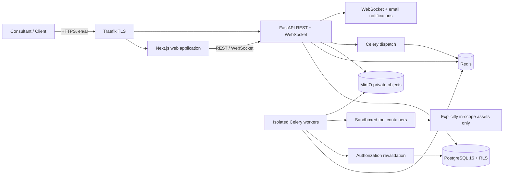
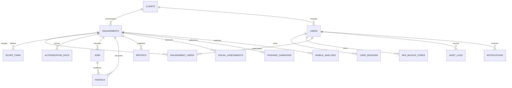
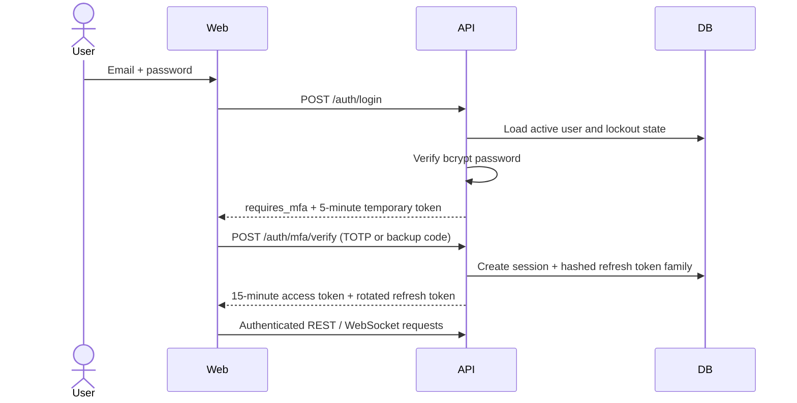
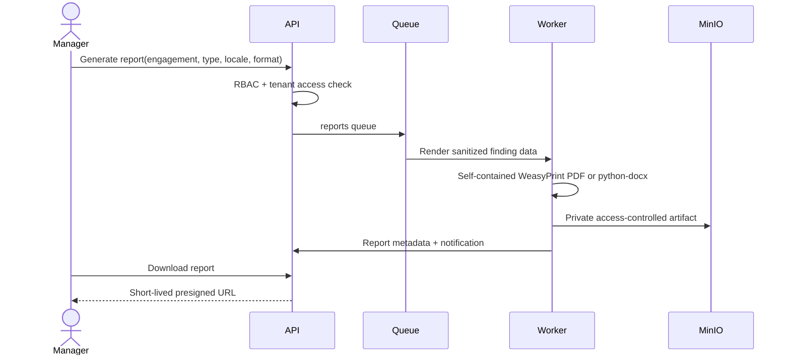

# CyberOps Hub Architecture

CyberOps Hub is a multi-tenant security operations platform for explicitly authorized assessments. The authorization gate is the central control plane: no scan, mobile analysis, impersonation search, or phishing dispatch can reach a worker until every engagement, scope, time-window, ownership, and signed-authorization check succeeds.

## System context



## Trust boundaries

1. **Browser boundary:** restrictive CORS, CSP, in-memory short-lived RS256 access tokens, and no persistent browser token storage. Production deployments may add cookie-based token storage with SameSite and CSRF controls at the TLS/application boundary.
2. **Tenant boundary:** every client-owned row carries an engagement/client relationship; PostgreSQL RLS provides defense in depth in addition to API filters.
3. **Dispatch boundary:** REST handlers and worker entry points both invoke the authorization gate. A queued job cannot run after its approval or testing window expires.
4. **Execution boundary:** each tool gets a read-only container, dropped capabilities, PID/CPU/memory limits, a dedicated egress-controlled network, and a hard timeout.
5. **Evidence boundary:** uploads are size/type checked, hashed, malware scanned, and stored outside the web root. Downloads use short-lived presigned URLs.

## Entity relationship model



## Login and mandatory MFA



## Job creation and authorization gate

```mermaid
sequenceDiagram
    actor Tester
    participant API
    participant Gate
    participant DB
    participant Queue
    participant Worker
    Tester->>API: Create job(targets, profile)
    API->>Gate: validate_job_authorization(...)
    Gate->>DB: Engagement + assignment + scope + docs
    Gate->>Gate: Time, CIDR, domain, exclusion and ownership checks
    alt Any check fails
        Gate->>DB: Immutable denial audit event
        Gate-->>API: 403 + reason code
        API-->>Tester: Action blocked; administrators alerted
    else All checks pass
        Gate->>DB: Immutable approval audit event
        API->>Queue: Enqueue signed job ID (never trusted arguments)
        Worker->>Gate: Revalidate immediately before execution
        Worker->>Worker: Start constrained tool container
    end
```

## Report generation



## Backend layout

- `app/api`: transport validation, response envelopes, RBAC dependencies.
- `app/services`: transactional business operations and tenant-aware queries.
- `app/security`: authentication, encryption, RBAC, and the non-bypassable authorization gate.
- `app/models` / `alembic`: persistent schema and controlled migrations.
- `app/tasks`: idempotent queue handlers; scan handlers revalidate authorization.
- `app/parsers`: untrusted tool output normalized into findings.

## Frontend layout

The App Router is locale-aware (`en`, `ar`) and uses React Server Components for shells, TanStack Query for server data, Zustand for ephemeral UI state, and reusable accessible components. Sensitive tokens are not written to local storage. RTL is a document-level direction change, not a CSS afterthought.

## Deployment and observability

Development uses Docker Compose; production places all services behind Traefik and never exposes PostgreSQL, Redis, MinIO, metrics, or workers publicly. Structured JSON logs exclude tokens, credentials, and raw evidence. Prometheus records request/worker health without sensitive labels. Health checks distinguish liveness from DB/Redis/object-store readiness.

## Failure and recovery policy

- Denials fail closed and are immutable audit events.
- Refresh-token reuse revokes the entire token family.
- A kill switch revokes queued work and stops active containers; workers check cancellation before each execution phase.
- Tool output is treated as untrusted data and sanitized before display or report rendering.
- PDF reports disable presentational-hint CSS and reject every local or network resource fetch; templates and inline styles are self-contained.
- Retention jobs delete object payloads before tombstoning metadata and record every deletion.
